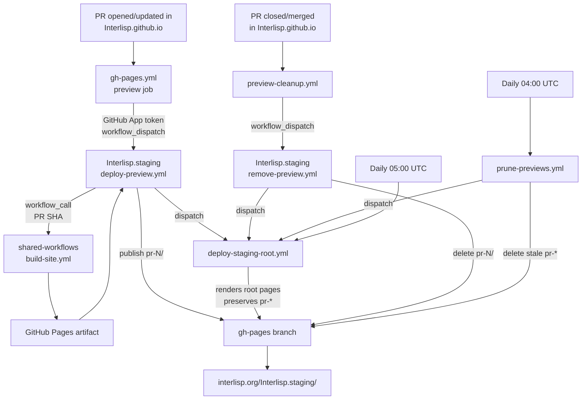

# Interlisp.staging

Deployment-only repository for the Interlisp.org staging previews.

This repository does **not** contain the website source. It contains the
automation that publishes temporary preview builds of pull requests from
[`Interlisp/Interlisp.github.io`](https://github.com/Interlisp/Interlisp.github.io)
and the small set of files that make up the staging site root.

- Staging index: <https://interlisp.org/Interlisp.staging/>
- Per-PR preview: `https://interlisp.org/Interlisp.staging/pr-<N>/`
- Production site: <https://interlisp.org/>

The staging site is public but kept out of search indexes. The effective
protection is the `<meta name="robots" content="noindex, nofollow">` in the
staging Hugo output and in the root templates. The root `robots.txt`
(`Disallow: /`) is defense-in-depth only: crawlers read the host-root
<https://interlisp.org/robots.txt> (which currently allows all), and a
`robots.txt` under a subpath is not authoritative. For robots-based blocking,
add `Disallow: /Interlisp.staging/` to the production host-root `robots.txt`
in `Interlisp.github.io`.

## How it fits together

Three repositories are involved:

| Repository | Role |
| --- | --- |
| [`Interlisp/Interlisp.github.io`](https://github.com/Interlisp/Interlisp.github.io) | Hugo source for the production site. Its `gh-pages.yml` workflow deploys production and dispatches staging previews. Its `preview-cleanup.yml` workflow removes previews when PRs close. |
| [`Interlisp/shared-workflows`](https://github.com/Interlisp/shared-workflows) | Organization-level reusable workflows. `build-site.yml` contains the complete Hugo/Zotero/PostCSS build pipeline used by both production and staging. |
| `Interlisp/Interlisp.staging` (this repo) | Deployment target. Builds a dispatched PR SHA with the shared workflow, publishes it under `pr-<N>/` on the `gh-pages` branch, and owns the staging root pages. |

`Interlisp.staging` never builds a branch of its own. The only deployable
source it holds is the root-page templates, the renderer, and the workflows.

### End-to-end flow



1. A same-repository pull request in `Interlisp.github.io` builds and its
   `preview` job dispatches `deploy-preview.yml` here with the PR number, PR
   head SHA, and the Hugo version. Fork PRs are skipped, as are dispatches when
   `STAGING_APP_ID` is not configured.
2. `deploy-preview.yml` calls `Interlisp/shared-workflows/.github/workflows/build-site.yml@main`
   with the PR SHA, `hugo-environment: staging`, and
   `base-url: https://interlisp.org/Interlisp.staging/pr-<N>/`.
3. The built artifact is published to `pr-<N>/` on the `gh-pages` branch. The
   workflow posts the preview URL back to the source PR, then dispatches
   `deploy-staging-root.yml`.
4. When the PR closes or merges, `preview-cleanup.yml` in
   `Interlisp.github.io` dispatches `remove-preview.yml` here. It deletes
   `pr-<N>/` and refreshes the root.
5. `prune-previews.yml` runs daily as a safety net and deletes any `pr-*`
   directory whose PR is no longer open.
6. `deploy-staging-root.yml` owns everything at the root of `gh-pages`. Every
   run deletes root entries except `.git` and `pr-*`, then writes the current
   root files. The root cannot drift back into a copy of a PR site.

## Workflows in this repository

| Workflow | File | Triggers | Responsibility |
| --- | --- | --- | --- |
| Deploy Preview | `.github/workflows/deploy-preview.yml` | `workflow_dispatch` from `Interlisp.github.io` | Build a PR SHA with the shared workflow and publish it to `pr-<N>/`; comment the URL on the PR; dispatch a root refresh. |
| Deploy Staging Root | `.github/workflows/deploy-staging-root.yml` | Push to `main` under `.github/pages/**`, `scripts/**`, or the workflow; `workflow_dispatch`; daily 05:00 UTC | Render and publish the staging root files; remove any non-allowlisted root entries. |
| Remove Preview | `.github/workflows/remove-preview.yml` | `workflow_dispatch` from `Interlisp.github.io` when a PR closes | Delete `pr-<N>/`; dispatch a root refresh. |
| Prune Stale Previews | `.github/workflows/prune-previews.yml` | Daily 04:00 UTC; `workflow_dispatch` | Delete `pr-*` directories whose PRs are not open; dispatch a root refresh. |
| Validate Staging Root | `.github/workflows/validate-root.yml` | Pull requests and pushes to `main` touching root sources | Run renderer unit tests and `actionlint`. |

`validate-root.yml` only triggers for changes under `.github/pages/**`,
`scripts/**`, `.github/workflows/deploy-staging-root.yml`, or
`.github/workflows/validate-root.yml`. Changes to `deploy-preview.yml`,
`remove-preview.yml`, or `prune-previews.yml` do not currently trigger it.

### Deploy Preview details

`deploy-preview.yml` has two jobs:

- `build` calls the shared `build-site.yml` workflow with the source repository,
  PR SHA, Hugo version, staging environment, and PR-specific base URL.
  Build tests are disabled for previews.
- `deploy` downloads the `github-pages` artifact, extracts it, and uses
  `peaceiris/actions-gh-pages` to publish only to `pr-<N>/` with
  `keep_files: true`.

The deploy job must never publish to the site root. GitHub Pages only honors a
root-level `404.html`, so per-PR `404.html` files in the Hugo output are never
served. Root behavior is owned by `deploy-staging-root.yml`.

### Deploy Staging Root details

The root workflow checks out the repository source and the `gh-pages` branch
into separate directories, then:

1. Reads the deployed `pr-*` directories from `gh-pages`.
2. Renders `index.html` and `404.html` and copies the static root files with
   `scripts/render_staging_root.py`.
3. Deletes everything at the `gh-pages` root except `.git` and `pr-*`.
4. Copies the rendered files into place, commits, and pushes.
5. Retries the push up to three times if another writer updates `gh-pages`
   first.
6. Polls the live site for up to ten minutes to verify the index, `robots.txt`,
   `root.css`, and the 404 status/body.

Because the workflow runs `find ... ! -name 'pr-*' -exec rm -rf`, it is the
authoritative owner of the root. Do not add files to the root of `gh-pages` by
hand; add them to `.github/pages/` and the renderer's static-file list instead.

### Remove Preview and Prune details

`remove-preview.yml` deletes `pr-<N>/` and exits cleanly if the directory does
not exist.

`prune-previews.yml` requires the `STAGING_APP_ID` variable and uses a minted
GitHub App token to list open PRs in `Interlisp.github.io`. It runs daily and
can be dispatched manually. The job is skipped when `STAGING_APP_ID` is unset.

Both workflows dispatch `deploy-staging-root.yml` with `if: always()` and
`continue-on-error: true`, so a root refresh failure does not mark a good
preview removal or prune as failed. The daily root run is the backstop.

## Root site design

`deploy-staging-root.yml` owns these files at the root of `gh-pages`:

| File | Source | Purpose |
| --- | --- | --- |
| `index.html` | `.github/pages/index.template.html` | Staging landing page listing deployed previews and linking to production. |
| `404.html` | `.github/pages/404.template.html` | Client-side redirect for missing PR paths; fallback page for everything else. |
| `root.css` | `.github/pages/root.css` | Shared stylesheet for the root pages. |
| `robots.txt` | `.github/pages/robots.txt` | Defense-in-depth `Disallow: /` in the subpath. The authoritative protection is the `noindex` meta tag; see the search-index note above. |
| `.nojekyll` | `.github/pages/.nojekyll` | Disables Jekyll processing on the Pages branch. |
| `pr-*` | Deployed previews | Preserved by the root workflow. |

The preview list is rendered into the HTML at deploy time, not fetched in the
browser. It reflects **deployed `pr-*` directories**, not open PRs. The list is
only as fresh as the last root deploy.

### 404 behavior

GitHub Pages serves the root `404.html` for missing paths under the entire
project site, including `pr-<N>/...`. The page runs an inline script early in
`<head>`:

1. Normalizes the path by removing trailing slashes and appending one.
2. Matches `^/Interlisp.staging/pr-(\d+)(?:/|$)`.
3. If the path is a PR path but not already the PR base, redirects to
   `/Interlisp.staging/pr-<N>/`, preserving query string and hash.
4. If the path is already the PR base, does **not** redirect. This is the loop
   guard for a removed preview or a failed build; the fallback page explains
   that the preview may have been removed or may still be deploying.
5. For non-PR paths, shows the fallback page with the requested path, the
   preview list, and a production link.

Both templates use `<base href="/Interlisp.staging/">`, so relative links such
as `pr-357/` and `root.css` resolve correctly even when `404.html` is served for
a nested path.

## Concurrency and `gh-pages`

All workflows that write to `gh-pages` join the same job-level concurrency
group:

```yaml
concurrency:
  group: staging-gh-pages
  cancel-in-progress: false
```

This serializes root refreshes, preview deploys, preview removals, and pruning.
`deploy-preview.yml` additionally keeps its workflow-level
`preview-<N>` group with `cancel-in-progress: true`, so a superseded build for
the same PR is canceled. `remove-preview.yml` keeps its
`remove-preview-<N>` group.

The group is queue-based. A burst of root refresh dispatches can collapse into
the newest pending run, but each run re-reads the deployed `pr-*` directories,
so the surviving run still produces the correct list. Manual `git push`es to
`gh-pages` are not serialized with the workflows.

## Access, variables, and secrets

| Name | Scope | Used for |
| --- | --- | --- |
| `STAGING_APP_ID` | Organization variable | Client ID for the staging GitHub App. Also enables the preview jobs in `Interlisp.github.io`. |
| `STAGING_APP_PRIVATE_KEY` | Organization secret | Private key for the staging GitHub App. |
| `GITHUB_TOKEN` | Automatic | Publishing to `gh-pages`, dispatching `deploy-staging-root.yml`, and branch checks. |

The GitHub App must be installed on both `Interlisp/Interlisp.staging` and
`Interlisp/Interlisp.github.io`. It is used to dispatch workflows across
repositories and to comment preview URLs on source PRs.

Dispatching workflows need `actions: write`; publishing needs
`contents: write`. The refresh step sets `GH_TOKEN` to `GITHUB_TOKEN` and runs:

```sh
gh workflow run deploy-staging-root.yml \
  --repo "${GITHUB_REPOSITORY}" --ref main
```

`workflow_dispatch` is the documented exception that allows a
`GITHUB_TOKEN`-triggered event to start a new workflow run.

## Repository layout

```text
.gitignore                  # ignores Python caches
.github/
  pages/
    .nojekyll               # copied to the site root
    404.template.html       # root 404 + redirect script
    index.template.html     # root landing page
    robots.txt              # copied to the site root
    root.css                # copied to the site root
  workflows/
    deploy-preview.yml
    deploy-staging-root.yml
    prune-previews.yml
    remove-preview.yml
    validate-root.yml
scripts/
  render_staging_root.py    # renders templates + static files
  test_render_staging_root.py
```

## Maintenance

### Routine operation

- Opening, updating, closing, or merging a same-repository PR in
  `Interlisp.github.io` is automatic. No action is needed here.
- Fork PRs do not get staging previews.
- If a preview is missing, check the `preview` job in the source PR's
  `gh-pages.yml` run, the `Deploy Preview` run here, and whether the `pr-<N>/`
  directory exists on `gh-pages`.
- If the root preview list is stale, run **Deploy Staging Root** manually. The
  daily 05:00 UTC run is the backstop.

### Changing the root pages

1. Edit `.github/pages/*.html`, `root.css`, `robots.txt`, or `.nojekyll`.
2. If adding a new static root file, add it to `STATIC_FILES` in
   `scripts/render_staging_root.py`. Anything not in that list or `pr-*` is
   deleted from the root.
3. Run the renderer tests:

   ```sh
   python3 -m unittest discover -s scripts -p 'test_*.py' -v
   ```

4. Preview the output locally:

   ```sh
   printf '357\n355\n' > /tmp/previews.txt
   python3 scripts/render_staging_root.py \
     --previews-file /tmp/previews.txt \
     --output /tmp/staging-root
   ```

5. Open a PR. If the PR touches `.github/pages/**`, `scripts/**`, or the root
   workflows, `validate-root.yml` runs the tests and `actionlint`. Merging to
   `main` triggers a root deploy automatically. Changes to the other workflows
   do not trigger validation, so run `actionlint` locally for those.

### Manual root deploy / recovery

If `deploy-staging-root.yml` cannot run, reproduce it manually. Render the root
files first (see the local preview command above), then:

```sh
git fetch origin gh-pages
git worktree add /tmp/staging-gh-pages origin/gh-pages

# Render first (see the local preview command above), then:
cd /tmp/staging-gh-pages
find . -mindepth 1 -maxdepth 1 \
  ! -name '.git' ! -name 'pr-*' -exec rm -rf {} +
cp -a /tmp/staging-root/. .

git add -A
git -c user.name='github-actions[bot]' \
    -c user.email='github-actions[bot]@users.noreply.github.com' \
    commit -m "Update staging root pages"
git push origin HEAD:gh-pages

cd -
git worktree remove /tmp/staging-gh-pages
```

The root workflow is safe to run repeatedly, subject to the timestamp caveat
below.

### Changing the site base path

`BASE_PATH` is defined once in `scripts/render_staging_root.py` and injected
into both templates as `{{BASE_PATH}}`. If the repository name or Pages URL
changes, update `BASE_PATH` there, the URLs in the workflows and README, and
the verification URLs in `deploy-staging-root.yml`.

### `gh-pages` branch requirements

- The branch must exist. `deploy-staging-root.yml` checks it out directly and
  fails if it is missing. If it is ever deleted, create it once or use the
  manual fallback.
- Staging uses the legacy Pages build from `gh-pages`. The Pages API reports
  `build_type: legacy`, `custom_404: true`, and `cname: null`. The
  `interlisp.org` custom domain belongs to the organization site,
  `Interlisp/Interlisp.github.io`, which reports `cname: interlisp.org` and
  `https_enforced: true`. Project sites are served under that domain path.
- Do not add a root `CNAME` here unless the staging site is intentionally given
  its own custom domain. The root workflow will delete it.

### Initial root transition

The first `Deploy Staging Root` run after a root-page change is also the
one-time cleanup. It deletes any stale PR-site copy at the root, including
`CNAME`, `sitemap.xml`, `css/`, `js/`, `scss/`, `favicons/`, and an old
`robots.txt`, then writes the allowlisted root files. No separate cleanup input
or manual step is required. If the automatic run does not happen, run the
workflow manually or use the manual procedure above.

### Verifying a deployment

After a root deploy:

```sh
curl -fsS https://interlisp.org/Interlisp.staging/ \
  | grep -q 'Interlisp staging environment'

curl -sS -o /dev/null -w '%{http_code}\n' \
  https://interlisp.org/Interlisp.staging/does-not-exist
# expect 404

git fetch origin gh-pages
git ls-tree --name-only origin/gh-pages
# expect only .nojekyll, 404.html, index.html, root.css, robots.txt, pr-*
```

In a browser, confirm that
`https://interlisp.org/Interlisp.staging/pr-<N>/nonexistent?x=1#section`
redirects to `https://interlisp.org/Interlisp.staging/pr-<N>/?x=1#section`, and
that a removed preview base shows the fallback page instead of looping. `curl`
does not execute the redirect script, so the redirect itself must be checked in
a browser. The Pages API should still report `custom_404: true` and
`cname: null`.

### Rollback

- Revert the workflow changes. Reverting `deploy-preview.yml` restores the old
  behavior where the next PR deploy overwrites the site root.
- The new root files can be removed from `gh-pages` manually, or by running the
  manual procedure with an empty rendered output directory.
- The removed stale root files were PR build artifacts and can be regenerated
  from a PR build if ever needed.

### Known limitations and gotchas

- **Root ownership is declarative.** Every root deploy deletes anything at the
  root that is not `.git`, `pr-*`, or one of the rendered files. Add new root
  files to the renderer first.
- **Timestamp-only commits.** `<!-- UPDATED -->` is stamped with the current
  UTC minute. A second root deploy in a later minute creates a timestamp-only
  commit instead of reporting "already up to date". This is harmless, but it
  means the workflow is not strictly no-op idempotent across minutes.
- **Scheduled workflows pause after inactivity.** GitHub disables schedules
  after 60 days of repository inactivity. Preview-triggered dispatches are the
  primary path; the schedule is only a backstop.
- **No server-side redirects.** GitHub Pages does not support them. The PR
  redirect runs client-side; with JavaScript disabled, the fallback page and
  preview list still work.
- **`actions: write` is broad.** It is required for workflow dispatch. A future
  refactor to a reusable `workflow_call` would remove the need for it.
- **`pr-*` names are reserved.** `prune-previews.yml` treats every `pr-*`
  directory as a preview and may delete it when no matching PR is open.

### Troubleshooting

| Symptom | Likely cause | Action |
| --- | --- | --- |
| No preview for a PR | Fork PR, `STAGING_APP_ID` unset, or source `preview` job failed | Check the source PR's `gh-pages.yml` run and organization variables. |
| Preview URL 404s | `pr-<N>/` missing or build failed | Check the `Deploy Preview` run and the `gh-pages` tree. |
| Preview base shows the fallback page | Preview base is missing (removed preview or failed deploy); the loop guard is working | Redeploy the preview or remove the stale link. |
| Root list stale | Root refresh dispatch failed or is queued | Run **Deploy Staging Root** manually. |
| Root contains unexpected files | A writer bypassed the root workflow | Run **Deploy Staging Root**; it deletes non-allowlisted root entries. |
| Root `robots.txt` missing | Root deploy failed | Run the root workflow to restore this defense-in-depth file; the `noindex` meta tag is the primary protection. |
| Staging appears in search results | A page is missing the `noindex` meta tag | Confirm the staging Hugo output and root templates include `noindex`; the subpath `robots.txt` alone is not authoritative. |
| Root workflow fails at checkout | `gh-pages` branch does not exist | Create the branch or use the manual fallback. |
| Push retries fail | Concurrent writer or branch protection | Inspect the run, then rerun or use the manual fallback. |

## Local development

Requirements: Python 3.10+ (the renderer uses `from __future__ import
annotations` and standard-library only).

```sh
python3 -m unittest discover -s scripts -p 'test_*.py' -v
```

Optional workflow linting, matching CI:

```sh
docker run --rm -v "$PWD:/repo" -w /repo rhysd/actionlint:1.7.12
```

CI pins the same `actionlint` version. Action references are pinned to exact
release tags where the moving major tag can lag action metadata; for example,
`actions/create-github-app-token` is pinned to `@v3.3.0` so `actionlint` sees
the `client-id` input. `actionlint` may not be available in every development
environment; CI in `validate-root.yml` is authoritative.

## Related repositories

- [`Interlisp/Interlisp.github.io`](https://github.com/Interlisp/Interlisp.github.io) —
  production site source and the workflows that dispatch staging.
- [`Interlisp/shared-workflows`](https://github.com/Interlisp/shared-workflows) —
  reusable `build-site.yml` used by both production and staging.

## Copyright

Copyright 2026 by Interlisp.org.
